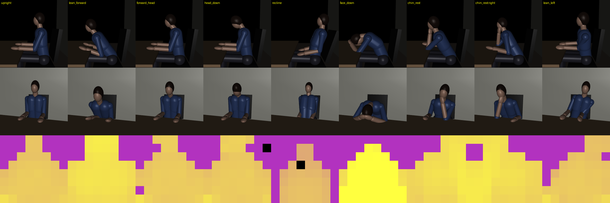

# 가상 L8 자세 시뮬레이터 (tof_sim)

실기 L8(VL53L8CX)이 없을 때 **자세 판정(규칙·AI)을 미리 시험하고 학습 데이터를 만드는** 도구다.
MuJoCo 로 책상 앞에 앉은 사람을 자세별로 세우고, 그 장면을 가상 L8 이 8×8 로 잰다.
출력은 실기 수집기(`dataset/tof_logger`)와 **같은 세션 형식**이다. 그래서 점검·평가·학습 코드를
실기 데이터에 그대로 쓸 수 있다.

```
사람·방·설치 무작위 ─► MuJoCo 장면 ─► 지시 자세 프로토콜(관절 각도, 팔·머리는 IK)
                                      │  15 Hz, 자세 전환·흔들림·숨·꾸벅임
                                      ▼
                        가상 L8 (칸당 36광선, 반사율·입사각·거리², 600 mm 안 반사 합침,
                                 Closest, 약한 신호 = 무효, 신호 따라 잡음)
                                      ▼
            세션 (tof_logger 형식) ─► 펌웨어 TofPosture.cpp 그대로 재판정 ─► evaluate.py
                                  └─► train_mlp.py (지시 자세로 학습·평가)
```



위 줄은 옆모습, 가운데는 정면, 아래는 가상 L8 의 8×8 거리다(노랑 = 가까움, 보라 = 먼 배경).
`python view.py --png docs/view.png` 로 만든다.

**시연 영상** [`docs/demo.mp4`](docs/demo.mp4) (91 s): 자세를 바꿔 가는 사람 + 가상 L8 8×8 + 프레임마다
정답·규칙(펌웨어 재판정)·AI(MLP) 판정. 영상 속 사람은 학습에 쓰지 않은 새 체형이다.
`python train_mlp.py data/sessions/sim* --save models/mlp_sim60.npz` 뒤
`python animate.py --out docs/demo.mp4` 로 만든다(`--pitch`·`--dist`·`--seed` 로 조건을 바꾼다).

## 무엇을 흉내 내나

| 요소 | 모델 | 무작위 범위 |
|---|---|---|
| 사람 | 캡슐·타원체 관절 인형. 머리카락·얼굴·옷·바지 반사율이 따로 있다 | 키 ±8%, 폭 ±10%, 머리카락 0.04~0.30, 옷 0.05~0.70 |
| 자세 | 11종(지시 자세 라벨). 몸통·목·머리는 각도 분포, 손·팔꿈치·엎드린 머리는 IK | 사람·시도마다 다시 뽑는다 |
| 시간 | 준비 구간 안 0.6~1.6 s 전환, 몸 흔들림(OU), 숨, 고개 돌림. 꾸벅임 0.3~1.0 s 낙하 → 복귀. 키보드 힐끗 | 4~12 s 간격 |
| 방 | 책상·의자(등받이가 젖힘을 따라감)·벽(30% 는 벽 없음) | 사람 거리 0.50~0.80 m, 책상 높이 0.70~0.76 m |
| 센서 설치 | 책상 위 높이, 위쪽 기울기, 좌우 틀어짐 | 높이 0.03~0.30 m, 기울기 0~25° |
| L8 광학 | 45°×45° 8×8, 칸당 6×6 광선. 신호 = 반사율·cos·1/r². 600 mm 안 반사는 한 대상(가중 평균), Closest | 문턱·잡음은 `L8Params` |

## 사용법

```sh
cd dataset/tof_sim
pip install -r requirements.txt                        # mujoco, numpy, pyyaml, pillow, pytest
python generate.py --sessions 20 --seed 1 --jobs 4      # 세션 20개(1개 ≈ 40 s, 5분 분량 프로토콜)
python evaluate.py data/sessions/sim*                   # 규칙 판정 혼동표·세션별 조건
python evaluate.py data/sessions/sim* --set lean_forward_mm=60   # 임계값 바꿔 재판정(재생성 없음)
python train_mlp.py data/sessions/sim* --folds 4        # AI 기준선(사람 단위 k-겹)
python view.py --png poses.png                          # 자세 그림 + 8×8
python view.py --viewer --labels chin_rest              # MuJoCo 뷰어로 돌려 보기
python animate.py --out demo.mp4                        # 시연 영상(정답·규칙·AI 판정 자막)
python ../tof_logger/inspect_session.py data/sessions/<세션>   # 실기 세션과 같은 점검
```

- 규칙 재판정은 **펌웨어 `TofPosture.cpp` 를 고치지 않고 그대로 컴파일**한다(`replay/tof_replay.cpp`).
  PATH 에 g++ 가 있으면 그걸 쓰고, 없으면 WSL 의 g++ 를 쓴다. 둘 다 없으면 `--no-rule`.
- 프로토콜은 실기 수집기 `dataset/tof_logger/config.yaml` 을 그대로 쓴다. `sim:` 칸은 시뮬레이터만 읽는다
  (턱 괸 손, 키보드 힐끗).
- 세션 폴더에는 `sim_truth.json`(프레임별 재실·끄덕임 정답)과 meta 의 사람·방·설치 값이 같이 남는다.

## 첫 결과 (2026-10-12, 시뮬레이션)

### 규칙 vs AI (60세션, 사람 단위 5겹)

| 규칙 enum 자세 프레임(11.9만) | 정확도 |
|---|---|
| 펌웨어 규칙 TofPosture | 47.6% |
| MLP 192→64→10 (가중치 1.3만 개, int8 ≈ 13 KB), 1 s 다수결 | **73.2%** |

- MLP 는 규칙에 없는 자세까지 10자세 전체 68.2%. 엎드림 81%, 좌우 기울임 76~78%, 턱괴기 71%.
  거북목·고개 숙임은 바른 자세와 거의 구분이 안 된다(12%·29%) — 8×8 로는 한계일 수 있다.
- 12세션일 때는 MLP 55.7% vs 규칙 39.3% 였다. 데이터가 늘수록 MLP 가 좋아진다.

규칙이 틀리는 방식(셋 다 8×8 의 성긴 해상도와 관련):

1. **자세 전환이 끄덕임으로 세어진다.** 젖혔다 돌아오기·엎드렸다 일어나기가 '떨어졌다 돌아옴'으로 잡혀 1분에
   2번이면 졸음이 켜지고 유지된다(바른 자세의 23% 가 drowsy). 끄덕임을 끄면 일치율이 오른다.
2. **머리 높이가 행 단위로만 움직인다.** 8×8 한 행은 사람 거리 0.8 m 에서 약 8 cm 다. 한 행만 바뀌어도
   '머리 8 cm 하강'이 되어 엎드림 문턱(75/135 mm)과 겹친다. 규칙은 54×42(1행 ≈ 1°)를 염두에 두고 만들어졌다.
3. **상체 앞으로 ↔ 턱괴기·엎드림 혼동.** 숙이면 머리 아래 몸통이 가까워지는데, 이것을 팔 기둥으로 본다.

센서를 위로 15° 넘게 기울인 설치에서 더 나빴다.

### 이 숫자를 믿으면 안 되는 이유

- 사람 모델이 캡슐 인형이다. 옷 주름·머리 모양·의자 팔걸이·모니터·책상 위 물건이 없다.
- L8 광학 숫자(검출 문턱·잡음·600 mm 합침)는 데이터시트 경향으로 잡은 추정값이다.
- 자세 각도 분포는 그럴듯하게 잡은 값이지 사람을 잰 것이 아니다.
- **따라서 시뮬레이션 점수는 실제 정확도가 아니다.** 쓸모는 세 가지다.
  - 규칙의 구조적 약점(위 1~3)을 미리 찾는다.
  - 학습·평가 코드를 실기 전에 완성해 둔다.
  - 시뮬레이션으로 사전학습하고 실기 데이터로 미세조정한다.
- 실기 L8 세션이 생기면 먼저 할 일이 있다.
  1. 같은 자세의 실기·시뮬레이션 8×8 을 나란히 놓고 `L8Params`(문턱·잡음)와 반사율 범위를 맞춘다.
  2. **최종 평가는 실기 지시 자세 세션으로만** 한다.

## 파일

| 파일 | 내용 |
|---|---|
| `tofsim/scene.py` | MJCF 장면(사람·책상·의자·벽), 반사율 표 |
| `tofsim/pose.py` | 자세 → 관절 각도, IK(MuJoCo 자코비안 감쇠 최소제곱) |
| `tofsim/motion.py` | 프로토콜 → 프레임별 자세·재실·정답, 꾸벅임·힐끗·흔들림 |
| `tofsim/l8.py` | 가상 VL53L8CX |
| `tofsim/rule.py`, `replay/tof_replay.cpp` | 펌웨어 규칙 재판정기 |
| `generate.py` · `evaluate.py` · `train_mlp.py` · `view.py` · `animate.py` | CLI |

테스트: `python -m pytest tests -q` (10개. 규칙 재판정 2개는 g++/WSL 이 없으면 건너뛴다).
