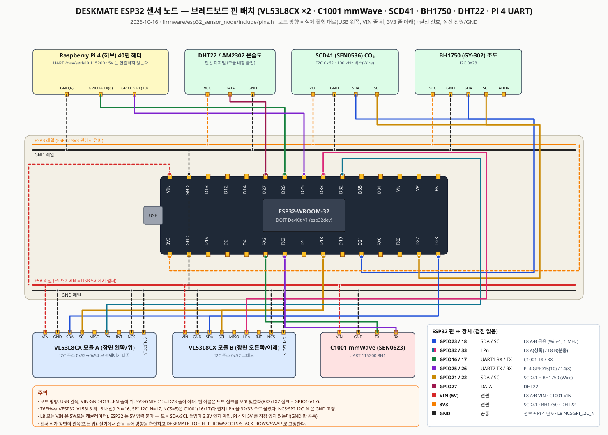

# ESP32 센서 노드 브레드보드 배선 — VL53L8CX ×2 · C1001 · 환경 센서 · Pi 4

기준: `firmware/esp32_sensor_node/include/pins.h` (2026-10-16). 그림: [`img/breadboard-esp32-node.svg`](img/breadboard-esp32-node.svg).

그림의 보드 방향은 **실제로 꽂힌 대로**다(2026-10-16 확인): USB 가 왼쪽, `VIN·GND·D13…EN` 줄이 **위**, `3V3·GND·D15…D23` 줄이 **아래**.
보드를 180° 돌려 꽂으면 USB 가 오른쪽으로 가고 줄 순서도 좌우로 뒤집히니 실크 이름으로 맞춘다.

## 왜 다시 배선하나

| 저장소 | 쓰던 핀 | 문제 |
|---|---|---|
| `76EHwan/ESP32-mmWave` · 팀 펌웨어 | C1001 ↔ **GPIO16(RX1) / GPIO17(TX1)** | 기준으로 유지 |
| `76EHwan/ESP32_VL53L8` | L8 SDA 23 · SCL 18 · **LPn 16 · SPI_I2C_N 17 · NCS 5** · INT 4 | LPn·SPI_I2C_N 이 C1001 UART 와 겹침 |
| 팀 펌웨어 환경 센서 | SCD41·BH1750 ↔ GPIO21/22 (I2C `Wire`) | SCD41 은 100 kHz 까지라 L8(1 MHz) 과 버스를 못 나눔 |
| 팀 펌웨어 Pi 4 링크 | GPIO25 TX2 / GPIO26 RX2 | 유지 |

그래서 **L8 두 개는 전용 I2C 버스(`Wire1`, GPIO23/18, 1 MHz)** 에 두고, **LPn 만 GPIO32/33** 으로 받는다.
NCS·SPI_I2C_N 은 I2C 모드 고정이라 GND 에 묶어 핀을 쓰지 않는다. INT·MISO 는 비운다.

## ESP32 DevKit V1 핀 배정 (전체)

| GPIO | 보드 실크 | 기능 | 상대 장치 | 비고 |
|---|---|---|---|---|
| 23 | D23 | I2C1 SDA (`Wire1`) | L8 A · L8 B SDA | 1 MHz. 선이 길어 init 실패하면 `DESKMATE_TOF_I2C_HZ=400000` |
| 18 | D18 | I2C1 SCL (`Wire1`) | L8 A · L8 B SCL | |
| 32 | D32 | 출력 | L8 **A** LPn | 부팅 때 A 만 먼저 켜 주소를 0x54 로 바꾼다 |
| 33 | D33 | 출력 | L8 **B** LPn | B 는 기본 주소 0x52 |
| 16 | RX2(실크) | UART1 RX | C1001 TX | 115200 8N1 |
| 17 | TX2(실크) | UART1 TX | C1001 RX | |
| 25 | D25 | UART2 TX | Pi 4 GPIO15 RX (물리 10) | 115200 8N1 |
| 26 | D26 | UART2 RX | Pi 4 GPIO14 TX (물리 8) | |
| 21 | D21 | I2C0 SDA (`Wire`) | SCD41 · BH1750 SDA | 100 kHz |
| 22 | D22 | I2C0 SCL (`Wire`) | SCD41 · BH1750 SCL | |
| 27 | D27 | 단선 디지털 | DHT22 DATA | |
| VIN | VIN | 5 V (USB) | L8 A·B VIN · C1001 VIN | L8 모듈은 온보드 레귤레이터 기준 |
| 3V3 | 3V3 | 3.3 V | SCD41 · BH1750 · DHT22 VCC | |
| GND | GND | 공통 | 전부 · Pi 4 물리 6 · L8 NCS·SPI_I2C_N | |

남는 핀: 4, 5, 13, 14, 19, 2(LED) · 입력 전용 34/35/36/39. 12·15·0 은 부팅 스트랩이라 비워 둔다.

## VL53L8CX 모듈 핀 → ESP32 (헤더 순서는 `76EHwan/ESP32_VL53L8` 의 모듈 기준)

| 모듈 핀 | A | B | 메모 |
|---|---|---|---|
| VIN | VIN(5 V) | VIN(5 V) | 5 V 레일 |
| GND | GND | GND | |
| SDA/MOSI | GPIO23 | GPIO23 | 두 모듈 같은 선 |
| SCL/CLK | GPIO18 | GPIO18 | 두 모듈 같은 선 |
| MISO | — | — | I2C 모드에서 안 씀 |
| LPn | **GPIO32** | **GPIO33** | 다름 |
| INT | — | — | 미사용 |
| NCS | GND | GND | I2C 모드 필수 |
| SPI_I2C_N | GND | GND | I2C 모드 |

SATEL-VL53L8 보드를 쓰면 PWREN 은 3.3 V(IOVDD) 로, AVDD/IOVDD 는 보드 규격대로 넣는다.
**ESP32 는 5 V 입력을 못 받는다** — 모듈 SDA/SCL 풀업이 3.3 V 쪽인지 확인하고, 5 V 풀업이면 레벨 시프터를 넣는다.

## 주소 배정 순서 (펌웨어 `sensors/tof/TofArray.cpp` 가 자동으로 한다)

1. 부팅: LPn A·B 둘 다 LOW (두 센서 다 I2C 에서 빠짐).
2. A 의 LPn HIGH → 0x52 로 init(펌웨어 업로드 1~2 s) → `set_i2c_address(0x54)`.
3. B 의 LPn HIGH → 0x52 그대로 init.
4. 이후 둘 다 15 Hz 8×8. ESP32 만 리셋되면 A 가 이미 0x54 에 있으므로 두 주소를 다 찔러 본다.
5. 한쪽이 죽으면 5 s 마다 그 센서만 다시 올린다. A 가 주소를 못 바꿨는데 B 가 0x52 로 살아 있으면 A 는 B 가 내려갈 때까지 기다린다.

## 격자 방향

센서 A 가 장면의 **왼쪽(가로 배치, 16×8)** 또는 **위(세로 배치, 8×16)** 다. 두 센서는 같은 방향으로 나란히,
시야(45°)가 조금 겹치게 붙인다. 실기에서 손을 들어 보고 아래 플래그로 고정한다(`platformio.ini` `build_flags`):

| 플래그 | 기본 | 뜻 |
|---|---|---|
| `DESKMATE_TOF_FLIP_ROWS` | 0 | 각 센서 8×8 위아래 뒤집기 |
| `DESKMATE_TOF_FLIP_COLS` | 1 | 각 센서 8×8 좌우 뒤집기 (ST 순서가 거꾸로) |
| `DESKMATE_TOF_STACK_ROWS` | 0 | 0 = A\|B 가로(16×8) · 1 = A 위 B 아래(8×16) |
| `DESKMATE_TOF_SWAP` | 0 | A/B 자리 바꾸기(배선 그대로) |
| `DESKMATE_TOF_COUNT` | 2 | 1 로 두면 A 만 쓴다 |

확인 절차는 [`../dataset/tof_logger/README.md`](../dataset/tof_logger/README.md) "방향 확인".

**2026-10-16 실기 확인(브레드보드, 거치대 전):** 손을 A 앞에 대면 격자 왼쪽 절반, 중심 위쪽에 대면 위쪽 행, B 에서는 팔이 A 에 붙은 열에
잡혔다 → 기본값(FLIP_ROWS=0 · FLIP_COLS=1 · 가로 배치 · SWAP=0) 그대로. 단 같은 실험에서 **LPn 선이 효과가 없었다**
(부팅 스캔 `[all LPn low] 0x52,0x54`): A/B 구분이 주소(0x54 가 A)로만 되므로, 완전 전원 재투입 뒤 둘 다 0x52 로 돌아오면 첫 init 이
충돌한다. LPn 배선(A→GPIO32, B→GPIO33, 모듈 LPn 핀이 3.3 V 에 묶여 있지 않은지)을 바로잡아야 한다.

## 처음 켤 때 보는 것

1. `pio run -e esp32dev -t upload && pio device monitor -b 115200` — 부팅 줄에 `VL53L8CX x2: ok_mask=3 grid=16x8`.
   `ok_mask=1` 이면 B, `=2` 면 A 가 안 올라온 것이고 `last_error=sensor<i>/<단계>/<코드>` 가 같이 찍힌다.
   - `no_ack`: SDA/SCL/LPn/NCS/SPI_I2C_N 배선, 전원.
   - `init` 실패: I2C 속도를 400 kHz 로, 선 길이 줄이기.
   - `set_i2c_address` 실패: A 를 올릴 때 B 의 LPn 이 HIGH 로 떠 있는지(배선 바뀜).
2. 1 Hz `{"t":"tof_feature",...}` 줄에 `sensors_ok`·`grid_width/height`·`posture`.
3. Pi 4 에서 `pi4-uart-check.sh` 로 `rx` 가 늘고(ToF 0x03 5 Hz + 0x04·0x20·0xF0 1 Hz ≈ 8 프레임/s), `/api/state` 의
   `sensor_summary.tof.posture` 가 나온다. Python 허브가 살아 있으면 같은 값이 `state/phase` 로 발행된다.

관련: [`hardware.md`](hardware.md) · [`data-spec.md`](data-spec.md) §13.1 · `firmware/README.md`.
