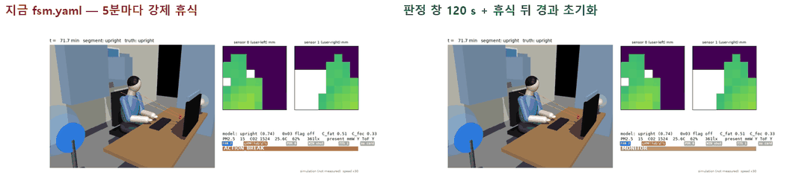
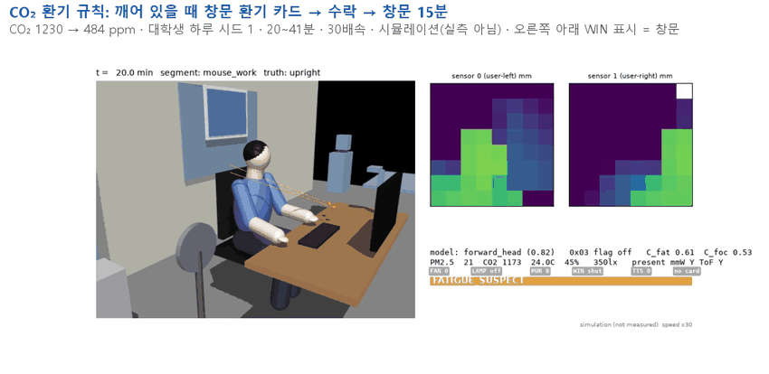

# 시뮬레이션·자세 모델 결과 정리 (PC · UBAI, 10-22 ~ 10-25)

PC 쪽(시뮬레이션 · ToF 자세 모델 · UBAI 학습) 결과를 팀이 한곳에서 보도록 모은 문서다. 지금 있는 것으로 먼저 만들었고, 끝나는 대로 더한다.

- **[시뮬]** = 합성 결과(tofsim MuJoCo ToF · life_sim 폐루프 · 가정한 사람·심박·반응). 실제 성능이 아니다.
- **[실측]** = 실제 센서 녹화. **10-19 녹화 1개**(정면 80 cm, VL53L8CX 2개)뿐이고, 일부 항목은 다른 회차 #1 을 같이 쓴다.
- 숫자는 원문(PC `tof-sim_ubai_results_1023|1024`, `handoff_laptop_20261024`, UBAI 보고서, `feat/reaction-ai` 의 `docs/reaction-ai.md`) 그대로 옮겼다. 원문끼리 다르면 둘 다 출처와 함께 적었다.

## 목차

| 주제 | 날짜 | 한 줄 결론 |
|---|---|---|
| [(a) 보드 자세 모델 결정](a-board-posture-model.md) | 10-22 ~ 10-24 | 보드 모델은 **opt_l8_c256 best** 유지. [실측] 두 센서 합침 F1 0.456 — 보강 학습 16개 모두 이보다 낮다(자세 보강 최고 0.391). [시뮬]에서는 자세 보강 8개 모두 0.813 을 넘었다(최고 0.846) — 시뮬과 실측이 엇갈린 사례. [실측] drowsy 재현은 모든 모델 0.16, 시연 졸음은 엎드리기로 |
| [(b) 실측 진단·보정](b-real-diagnosis-calibration.md) | 10-23 ~ 10-25 | [실측] 가장 큰 오류는 misplaced 헛판정. 안내 자세 기준점은 같은 녹화 0.387 → 0.636 이지만 다른 회차엔 안 옮겨짐. 장착 기울기 15~20° 권장 [시뮬] |
| [(c) 자리 비움 리셋](c-away-reset.md) | 10-24 | 보드(v4)에서는 `AWAY_RESET_S=0` — 리셋하면 복귀 0~60 s 정확도 0.790 → 0.633 [시뮬]. v7b 는 반대라 모델을 바꾸면 다시 잼. 계정1 의 60 s 권고는 철회 |
| [(d) 시연 FSM 프로파일](d-demo-fsm-profile.md) | 10-24 ~ 10-25 | demo-B: 졸음 뒤 첫 개입 102 s, 졸기 전 헛개입 0 [시뮬]. 첫 깨우기 실패 정체 수정(2b9252a) 뒤 리허설 12/12 깸. 통합 hub(16900b3)는 공통모델 학습기가 깨우기를 662 s 까지 늦췄고, 2e9d9be 에서 102 s 로 복구 [시뮬] |
| [(e) life_sim v8](e-lifesim-v8.md) | 10-23 ~ 10-24 | 심박 졸음 규칙(Bp + 유지 80 %)으로 놓친 졸음 9/12 → 0/12, 헛개입 0. ToF 정지 12 mm 로 약한 끄덕임 957 → 632 s. CO₂ 환기 규칙으로 CO₂ ≥ 1000 시간 117.9 → 50.7 분 [모두 시뮬] |
| [(f) 반응학습 AI v10~v14](f-reaction-ai.md) | 10-23 ~ 10-25 | AI 는 헛개입 −22~31 %·강제 휴식 −18~24 %. v14: 놓침을 줄인 건 낮춤 폭 0.05(정책 가중은 효과 없음). 시연 페르소나 v13c 위치 5곳: 대학생 놓침 44.0 → 42.4 %, 수험생 67.2 → 61.3 %(헛개입 +1.2/일) [시뮬] |
| [(g) 책 공부 자세 보강](g-book-study.md) | 10-24 ~ 10-25 | 1차(v7b 출발): 책 읽기 0.17 → 0.90 [시뮬], 대신 거북목 0.61 → 0.14, [실측] F1 0.333~0.368. 2차(v4 출발): 책 읽기 0.39 → 0.15~0.18, [실측] 합침 F1 0.456 → 0.231~0.237 — 실패 |

## 데이터 (`data/`, 집계 값만)

| 파일 | 크기 | 내용 |
|---|---|---|
| [`reaction_ai_days.csv`](data/reaction_ai_days.csv) | 423 KB | 반응학습 실행 310개 × 날마다(4,340 줄) — 세트·사람·arm·위치·날별 피로·놓침·개입·학습 상태. 열 설명은 [(f)](f-reaction-ai.md) 끝 |
| [`real_1019_fused_scores.csv`](data/real_1019_fused_scores.csv) | 1 KB | [실측] 10-19 녹화, 자세 모델 17개, 두 센서 합침 acc·macro-F1 |
| [`placement_1023_posture_tour.csv`](data/placement_1023_posture_tour.csv) | 2 KB | [시뮬] 기기 배치 20개(방위·조준·기울기 오차·거리)별 자세 정확도·자세별 재현 |
| [`away_reset_v4_returns.csv`](data/away_reset_v4_returns.csv) | 1 KB | [시뮬] v4, 자리 비움 리셋 값별 복귀 뒤 정확도 |
| [`vent_rule_co2_curves.json`](data/vent_rule_co2_curves.json) | 48 KB | [시뮬] CO₂ 환기 규칙 끔/켬, 각본 × 시드별 분 단위 CO₂·창문·재실·카드 |

원본 로그(`.jsonl`)·데이터셋(`.npz`)·모델 가중치(`.pt` `.bin` `.onnx`)·자가 응답 라벨은 넣지 않았다.
저장소 `.gitignore` 가 `*.csv` 를 막고 있어(수집 데이터·라벨 보호) 이 폴더의 집계 표만 `!docs/sim-results/data/*.csv` 로 예외를 두었다. 보드용 모델 export 는 팀 저장소 Release `pi4-tof-bundle-20261023` 에 있다.

## 그림 (`img/`)

| 파일 | 보여 주는 것 |
|---|---|
|  [`fsm_before_after_x30.gif`](img/fsm_before_after_x30.gif) (4.0 MB) | 개발자 하루 72~97 분, 30 배속. 왼쪽 지금 fsm.yaml(5 분마다 강제 휴식) · 오른쪽 판정 창 120 s + 휴식 뒤 경과 초기화 — 강제 휴식 11 → 1 회 [시뮬] |
|  [`vent_window_x30.gif`](img/vent_window_x30.gif) (4.1 MB) | 대학생 하루 20~41 분, 30 배속. 깨어 있을 때 창문 환기 카드 → 수락 → 창문 15 분, CO₂ 1230 → 484 ppm [시뮬] |

두 GIF 모두 원본(9.2 MB · 7.2 MB)에서 프레임을 하나 걸러 빼고(재생 시간은 같음) 크기를 줄였다.

## 추후 추가

- 반응학습 **v14 위치 5곳 · 공통모델 출발** — 지금 v14 는 위치 1곳(−20°) 결과뿐
- **기기 위치 3구역 입력 모델** — 위치 정보를 입력으로 받는 자세 모델(UBAI 학습 중)
- 시연 **v14c 위치 5곳**
- 반응학습 날마다 표(`data/reaction_ai_days.csv`)에 v13c 위치 5곳 확장분·v14 추가

10-25 에 더한 것: 반응학습 v14(위치 1곳) · 시연 페르소나 v13c 위치 5곳(처음 넣은 한 위치 수치 정정) · 통합 hub 리허설(16900b3·2e9d9be) · 책 공부 2차(v4 출발, 실패).
