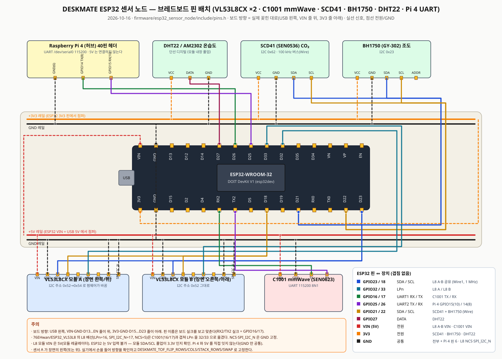

# schematic — ESP32 센서 노드 배선 (2026-10-16)

실물 조립용 배선 정리. 핀 번호의 원본은 `firmware/esp32_sensor_node/include/pins.h`(브랜치 `feat/tof-node-hw`)이고,
이 폴더는 그 값을 브레드보드에 옮길 때 보는 그림과 표다.

| 파일 | 내용 |
|---|---|
| [`esp32-node-breadboard.md`](esp32-node-breadboard.md) | 전체 배선: VL53L8CX ×2 · C1001 mmWave · SCD41 · BH1750 · DHT22 · Pi 4 UART. 핀 충돌 정리, I2C 주소 배정 순서, 격자 방향 플래그, 첫 점검 |
| [`img/breadboard-esp32-node.svg`](img/breadboard-esp32-node.svg) | 브레드보드 핀 배치 그림. 보드 방향은 실제로 꽂힌 대로(USB 왼쪽, `VIN…EN` 줄 위, `3V3…D23` 줄 아래) |



## 1단계: ToF 만 먼저 (나머지 센서는 비워 둔다)

ESP32 DevKit V1 실크 이름 기준. 지금 꽂힌 방향에서 `3V3 GND D15 … D22 D23` 줄이 **아래**, `VIN GND D13 … VP EN` 줄이 **위**다.

### VL53L8CX 모듈 2개 → ESP32

| 모듈 핀 | 모듈 A | 모듈 B | 위치 |
|---|---|---|---|
| VIN | VIN(5 V) | VIN(5 V) | 위 줄 맨 왼쪽 `VIN` (USB 5 V) |
| GND | GND | GND | 아무 `GND` |
| SDA/MOSI | **D23** | **D23** | 아래 줄 맨 오른쪽. 두 모듈이 같은 선 |
| SCL/CLK | **D18** | **D18** | 아래 줄. 두 모듈이 같은 선 |
| LPn | **D32** | **D33** | 위 줄. 서로 다른 핀 |
| NCS | GND | GND | I2C 모드 |
| SPI_I2C_N | GND | GND | I2C 모드 |
| MISO · INT | 비움 | 비움 | |

- A 와 B 의 차이는 LPn 하나다. **D32 에 꽂은 쪽이 장면의 왼쪽(세로 배치면 위)** 이 된다.
- 펌웨어가 부팅 때 B 의 LPn 을 LOW 로 눌러 둔 채 A 를 0x52→0x54 로 바꾸고, 그 다음 B 를 0x52 그대로 올린다. 배선에서 할 일은 없다.
- 모듈 헤더 순서는 `76EHwan/ESP32_VL53L8` 의 모듈(VIN GND SDA SCL MISO LPn INT NCS SPI_I2C_N) 기준.
  SATEL-VL53L8 보드면 PWREN 을 3.3 V 에 묶는다. ESP32 는 5 V 입력을 못 받으니 모듈 SDA/SCL 풀업이 3.3 V 인지 확인한다.
- 왜 `76EHwan/ESP32_VL53L8` 배선(LPn 16 · SPI_I2C_N 17 · NCS 5)을 그대로 안 쓰나: GPIO16/17 은 C1001 mmWave UART(`76EHwan/ESP32-mmWave`, 팀 펌웨어 모두)다.

### ESP32 → Raspberry Pi 4 (허브)

Pi 4 40핀 헤더, **물리 번호** 기준. 6·8·10번은 바깥쪽 줄에 나란히 있다.

| ESP32 | Pi 4 헤더 | 뜻 |
|---|---|---|
| **D25** (위 줄) | **물리 10번** GPIO15 RXD | ESP32 송신 → Pi 수신 |
| **D26** (위 줄) | **물리 8번** GPIO14 TXD | Pi 송신 → ESP32 수신 |
| **GND** | **물리 6번** GND | 공통 GND, 필수 |

- 5 V 는 서로 잇지 않는다. ESP32 는 PC USB, Pi 4 는 자기 어댑터, GND 만 묶는다.
- Pi 4 쪽 `/dev/serial0` 설정·getty 정지·권한은 `hub/atlas/tools/pi4-uart-check.sh --fix` (상세: `hub/atlas/README.md`).

### 켜서 확인

```sh
cd firmware/esp32_sensor_node
pio run -e esp32dev -t upload
pio device monitor -b 115200
```

부팅 줄 `VL53L8CX x2: ok_mask=3 grid=16x8` 이면 둘 다 올라온 것. `ok_mask=1` 이면 B, `=2` 면 A 가 안 올라온 것이고
`last_error=sensor<i>/<단계>/<코드>` 가 같이 찍힌다(`no_ack` = 배선·전원, `init` = I2C 속도를 400 kHz 로, `set_i2c_address` = A 올릴 때 B 가 켜져 있음).
1 Hz 로 `{"t":"tof_feature",...}` 줄에 `posture`·`sensors_ok` 가 나온다.

## 2단계: 나머지 센서

C1001(GPIO16/17), SCD41·BH1750(GPIO21/22), DHT22(GPIO27)는 [`esp32-node-breadboard.md`](esp32-node-breadboard.md) 의 전체 표와 그림대로 붙인다.
